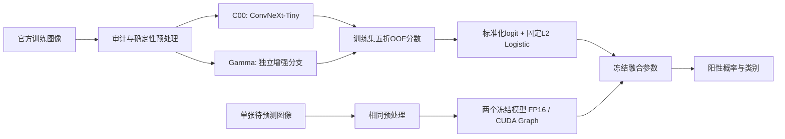

# 青光眼筛查：从实验基线到可复核推理

**Imbalanced fundus classification · OOF stacking · Reproducible inference**

一个面向眼底图像青光眼二分类的完整机器学习项目：从数据审计、迁移学习和受控消融，到训练集OOF融合、概率核验与推理加速。项目同时保留一套独立的ACRIMA研究基线，展示交叉验证、概率校准和测试集隔离的实现。


[](https://github.com/yeashun/glaucoma-screening/actions/workflows/tests.yml)

> 本仓库公开项目代码、配置与汇总结果，不包含比赛原始数据、逐图标签/预测、训练权重或账号信息。它是研究与竞赛工程记录，不是经过临床验证的诊断产品。

## 结果概览

| 项目 | 结果 | 统计口径 |
| --- | --- | --- |
| 比赛官网显示成绩 | **98.13分** | 项目作者反馈；原版与加速版CSV均取得该显示分数；不是分类准确率 |
| 最佳融合验证AUROC / AP | **0.987405 / 0.827118** | 官方验证划分；AP与梯形PR-AUC分别记录 |
| 加速版单图端到端耗时 | **80.203ms** | RTX4090，自选100张、5预热、batch=1串行3轮；**不是T4验收结果** |
| 加速实现与当前CSV一致性 | **0张不一致，最大概率差0** | 上述100张连续3轮，检查标签、排序和概率 |
| 推理模型及必要JSON | **223.50MB** | 两路ConvNeXt-Tiny，按实际推理加载文件统计 |
| 独立ACRIMA研究测试AUROC | **0.984493** | 独立数据与评估协议，不能与比赛分数直接比较 |

比赛成绩由 **E00的97.23 → C00的97.96 → C00＋Gamma融合的98.13** 逐步提升。最后一项融合使用训练集五折OOF拟合标准化logit上的Logistic回归；官方验证集没有参与融合系数拟合，测试图没有用于训练或参数拟合。详细结果见[实验记录](docs/experiments.md)与[汇总数据](docs/results/competition.csv)。

## 核心工作

- **数据与评估**：处理可变分辨率、EXIF方向、黑边和缺失年龄；通过SHA与感知哈希审计重复风险；区分AUROC、AP与梯形PR-AUC，保留种子复核和Bootstrap结论。
- **实验设计**：比较EfficientNet-V2-S、ConvNeXt-Tiny、排序损失、Gamma增强、权重衰减、分辨率、年龄分支与EMA；保留没有改善主指标的结果，避免只展示成功实验。
- **融合与泄漏控制**：外折只生成OOF，checkpoint由内部验证选择；归一化与融合参数只拟合训练OOF；每个输入保留来源与哈希检查。
- **工程交付**：训练断点与原子写出、共享推理入口、FP16和CUDA Graph、保持原像素计算的Pillow行并行；以标签、排序与概率误差共同约束加速实现。



## 仓库结构

```text
competition/                 比赛项目，单独的数据与训练路径
  glaucoma/                  初始模型、数据处理、指标与ROI组件
  configs/                   E00、C00等冻结实验配置
  v2_experiment/             缓存、骨干/正则/分辨率对照训练
  v3_experiment/             Gamma、Age、EMA、OOF与融合
  experiments/E_AUC01/       BCE + pairwise排序微调实验
  deployment/                共享Predictor、cost.py与加速源码
research/acrima/              独立ACRIMA基线、校准与合成测试
docs/                        方法、实验、复现与项目经历说明
tools/                       本地私有产物导入与公开文件检查
tests/                       无真实数据、无下载、无GPU的合成回归检查
licenses/                    上游许可证原文
```

两个项目的`glaucoma`包独立使用；请按各自目录运行，**ACRIMA不是本比赛的训练数据或医学预训练来源**。[独立研究模块](research/acrima/README.md)给出完整边界。

## 快速开始

仅运行合成检查，无需比赛数据或已训练权重：

```bash
python -m venv .venv
# Linux/macOS: source .venv/bin/activate
# Windows PowerShell: .venv\Scripts\Activate.ps1
python -m pip install torch==2.10.0 torchvision==0.25.0 --index-url https://download.pytorch.org/whl/cpu
python -m pip install -r requirements-dev.txt
python -m unittest discover -s tests -v
python tools/check_public_files.py
```

训练需自行取得授权数据，GPU环境需安装匹配的CUDA版PyTorch。典型C00训练入口：

```bash
cd competition
python tools/download_weights.py
python v2_experiment/build_cache.py --data-root /authorized/official \
  --cache-root cache/384 --size 384 --workers 4
CUDA_VISIBLE_DEVICES=0 python v2_experiment/train.py \
  --config configs/C00_s42.json --data-root /authorized/official \
  --cache-root cache/384 --run runs/C00_s42
```

权重下载只使用通用ImageNet初始化；GPU编号由运行者指定。完整的缓存、Gamma、OOF和私有权重推理命令见[复现指南](docs/reproduction.md)。没有数据和训练产物时，不能直接复现官网分数。

**公开源码默认使用系统Pillow；80.203ms来自原离线并行Pillow运行时与特定软硬件环境。** 仓库保留其修改前后C源码和加载逻辑，但不分发编译二进制。标准Pillow路径可运行，不保证相同延迟；T4正式复测状态仍为未完成。

## 阅读路线

1. [方法设计](docs/method.md)：预处理、损失、OOF融合与推理路径。
2. [实验取舍](docs/experiments.md)：哪些改动有效、哪些没有通过复核。
3. [数据和结果边界](docs/data-and-results.md)：数据授权、指标口径和部署限制。
4. [复现指南](docs/reproduction.md)：环境、目录与可执行入口。
5. [项目经历说明](docs/project-experience.md)：适合简历和技术面试的精简表述。
6. [发布前核验](docs/validation.md)：11项比赛回归检查与22项独立ACRIMA合成测试。

本项目原创代码采用MIT许可证；Pillow派生源码与其他上游材料分别适用其原许可证，见[第三方说明](THIRD_PARTY_NOTICES.md)。
